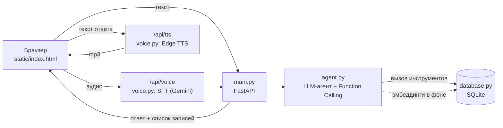

# Голосовой AI-ассистент для задач и встреч

Прототип ассистента, который управляет личными задачами, напоминаниями и встречами на естественном языке. Пользователь говорит или пишет в свободной форме ("Напомни завтра в 10 утра позвонить Ивану"), ассистент понимает запрос, выполняет действие с данными и отвечает текстом и голосом.

## Возможности

| Сценарий | Пример запроса |
|---|---|
| Создание задачи / напоминания | "Напомни мне завтра в 10:00 позвонить Ивану", "В пятницу нужно отправить отчет", "В четверг в 8:00 надо сходить на медосмотр" |
| Создание встречи | "Добавь встречу с командой завтра в 15:00", "В четверг в 11:00 у меня встреча с дизайнером" |
| События за период | "Что у меня сегодня?", "Какие задачи на завтра?", "Что запланировано на эту неделю?" |
| Поиск старых записей по смыслу | "Найди задачу про презентацию", "Когда у меня была встреча с Иваном?", "Я ставил задачу по договору, найди ее" |

**Дополнительные сценарии, которые могут использоваться:**

- уточняющий вопрос при нехватке данных: "Поставь встречу с Иваном завтра" -> "На какое время поставить встречу?";
- относительные даты: "послезавтра", "в пятницу", "через два часа", "на следующей неделе";
- контекст диалога: "А перенеси ее на завтра в 16:00", "Отметь ее выполненной";
- изменение, удаление и отметка выполненной голосом или кнопками в списке;
- предупреждение о пересечении встреч;
- семантический поиск по эмбеддингам;
- часовой пояс пользователя: "завтра в 10" считается по времени браузера, а не сервера;
- понятные сообщения об ошибках вместо сбоев (лимит API, неверный ключ, нет сети).

## Архитектура



Слои разделены по ответственности:

| Модуль | Ответственность |
|---|---|
| `app/voice.py` | Голос: распознавание речи (мультимодальный вход Gemini) и синтез (Edge TTS) |
| `app/agent.py` | LLM-агент: системный промпт с текущими датой и временем пользователя, инструменты, цикл вызова функций, память диалога |
| `app/database.py` | Хранение: SQLite, репозиторий записей, гибридный поиск, проверка конфликтов |
| `app/main.py` | REST API (FastAPI), без бизнес-логики |
| `app/timeutils.py` | Часовые пояса |
| `app/config.py` | Настройки из переменных окружения |
| `static/index.html` | Интерфейс: чат, кнопка записи голоса, список записей с фильтрами |

**Как обрабатывается запрос.** Агент передает модели историю диалога и пять инструментов: `create_record`, `get_schedule`, `search_records`, `modify_record`, `delete_record`. Модель сама решает, какой инструмент вызвать и с какими аргументами: относительные даты она переводит в `YYYY-MM-DD HH:MM` по текущему времени из промпта. Агент выполняет вызов, возвращает результат модели и получает ответ на естественном языке. После успешного создания записи без конфликтов подтверждение собирается шаблоном, без второго обращения к модели.

**Хранение.** Таблица `items`: тип (`task` / `meeting` / `reminder`), название, описание, дата и время события, дата создания, статус (`pending` / `completed`), вектор эмбеддинга (JSON).

**Поиск.** Гибридный: совпадение подстроки (точность для имен) плюс косинусное сходство эмбеддингов `gemini-embedding-001` (поиск по смыслу, "договор" <-> "контракт").

### API

| Метод | Путь | Назначение |
|---|---|---|
| POST | `/api/chat` | Текстовый запрос -> ответ ассистента и актуальный список записей |
| POST | `/api/voice` | Аудио -> распознавание -> ответ ассистента |
| POST | `/api/tts` | Текст -> mp3 |
| GET | `/api/items` | Все записи |
| PATCH / DELETE | `/api/items/{id}` | Ручное изменение и удаление из интерфейса |
| GET | `/api/health` | Проверка работоспособности |

## Технологии

| Задача | Выбор | Почему |
|---|---|---|
| Backend | Python 3.11+, FastAPI | Быстрый старт, async, автодокументация `/docs` |
| LLM | Google Gemini (`gemini-3.5-flash`) через `google-genai` | Нативный Function Calling, хороший русский, бесплатный тариф |
| Распознавание речи | Gemini (мультимодальный вход) | Тот же ключ и SDK, без отдельного STT-сервиса |
| Синтез речи | Edge TTS | Бесплатно, естественные русские голоса, без ключа |
| Эмбеддинги | `gemini-embedding-001` | Семантический поиск тем же ключом |
| База данных | SQLite | Ноль настройки, достаточно для прототипа |
| Интерфейс | HTML + Tailwind (CDN) + чистый JS | Без сборки, одна страница |
| Тесты | pytest | Без сети и ключа: Gemini подменяется фейковым клиентом |

## Запуск локально

Нужны Python 3.11+ и ключ Gemini API (бесплатно на https://aistudio.google.com).

```bash
git clone https://github.com/Rat896/voice-assistant-tasks.git
cd voice-assistant-tasks
python -m venv venv
```

Активируйте окружение: `source venv/bin/activate` (Linux / macOS) или `venv\Scripts\Activate.ps1` (Windows PowerShell).

```bash
pip install -r requirements.txt
cp .env.example .env
```

В `.env` впишите `GEMINI_API_KEY` (на Windows вместо `cp` используйте `copy`), затем запустите сервер:

```bash
uvicorn app.main:app --reload --port 8000
```

Откройте http://localhost:8000. Микрофон работает на `localhost` и по HTTPS. Пошаговая инструкция и разбор частых проблем: [SETUP.txt](SETUP.txt).

**Через Docker:**

```bash
docker build -t voice-assistant .
docker run -p 8000:8000 --env-file .env voice-assistant
```

**Тесты:**

```bash
pip install pytest
pytest -v
```

### Настройки (переменные окружения)

| Переменная | По умолчанию | Описание |
|---|---|---|
| `GEMINI_API_KEY` | — | Ключ Gemini API (обязательно) |
| `MODEL_NAME` | `gemini-3.5-flash` | Модель агента и распознавания речи |
| `EMBEDDING_MODEL` | `gemini-embedding-001` | Модель эмбеддингов для поиска |
| `THINKING_LEVEL` | `low` | Глубина "размышления" модели; ниже — быстрее ответ |
| `DATABASE_PATH` | `tasks.db` | Файл SQLite |
| `DEFAULT_TIMEZONE` | `UTC` | Запасной часовой пояс, если браузер его не передал |
| `TTS_VOICE` | `ru-RU-SvetlanaNeural` | Голос озвучки |

## Принятые решения

- **Function Calling вместо правил и регулярных выражений.** Модель сама выбирает действие, поэтому "Что у меня сегодня?", "Какие планы на сегодня?" и "Покажи встречи на сегодня" работают без списка команд.
- **Текущие дата, время и день недели пользователя в каждом промпте.** Модель корректно считает "в пятницу", "через два часа", "до конца недели". Часовой пояс приходит из браузера.
- **Правила поведения в промпте:** у встречи и напоминания без времени - уточняющий вопрос, у задачи без времени - 09:00 без переспрашивания; при пересечении встреч - предупреждение; короткий ответ без разметки, потому что он озвучивается.
- **Собственный цикл вызова инструментов вместо автоматического в SDK.** Он позволяет ответить на создание записи шаблоном без второго запроса к модели: ответ приходит быстрее, а лимит бесплатного тарифа расходуется вдвое медленнее.
- **Медленное - вне ответа пользователю.** Эмбеддинг новой записи считается в фоновом потоке, озвучка запрашивается браузером отдельно, поэтому текст и обновленный список видны сразу.
- **Гибридный поиск** (подстрока + эмбеддинги): точные совпадения по именам и поиск по смыслу.
- **SQLite и память процесса для истории диалога** - минимум инфраструктуры для прототипа.
- **Один провайдер (Gemini) для LLM, STT и эмбеддингов** - один ключ и SDK, проще запуск и деплой.

## Что улучшил бы при наличии времени

1. **Напоминания, которые срабатывают:** фоновый планировщик и push-уведомления или звонок в браузере в нужное время (сейчас напоминание только сохраняется).
2. **Ниже задержка голоса:** распознавание и обработка запроса одним обращением к модели, потоковый режим (WebSocket / Live API / gRPC) вместо цикла "записал -> отправил -> ждешь".
3. **Несколько пользователей:** авторизация, привязка записей к пользователю, история диалога в БД вместо памяти процесса.
4. **PostgreSQL + pgvector** - постоянное хранение и масштабируемый семантический поиск.
5. **Повторяющиеся события** (RRULE) и синхронизация с Google Calendar / CalDAV.
6. **Асинхронный клиент Gemini**, чтобы долгие запросы одних пользователей не задерживали других.
7. **Устойчивость к лимитам:** очередь с повторами, резервная модель при перегрузке, отдельное сообщение об исчерпании дневной квоты.
